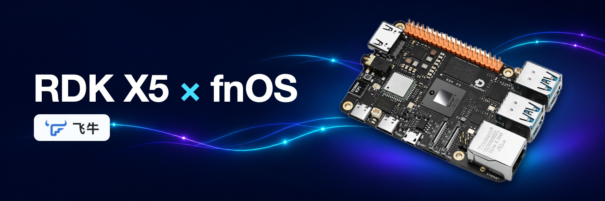

<h1 align="center">
  
</h1>

  <strong>用 RDK X5 搭建家庭 NAS</strong> 
  文件共享 · 智能相册 · 影音服务 · BPU / VPU 硬件加速

  
  
  

> [!IMPORTANT]
> **v0.3.1 完整镜像已发布。** r27 在 RDK X5 真板通过首次设置、外置卷导入、个人/团队文件夹 SMB 自动共享、Wi-Fi、影视 VPU 和独立加速包 0.3.5 验收。 [下载 v0.3.1](https://github.com/xuguosheng110/rdk-x5-fnos/releases/tag/v0.3.1)：5 个镜像分卷、3 个加速包分卷、`merge-image.py`、内核源码和 `SHA256SUMS`。新上传照片的 BPU 人脸自动索引待复验，见 [RELEASE_NOTES.md](RELEASE_NOTES.md)。

## 快速开始

准备 **RDK X5、至少 32 GB 的 microSD（TF）系统卡、读卡器、有线网络和独立
USB 数据盘**。系统卡安装系统及飞牛原生应用。照片、视频、相册模型和原生应用元数据使用外置卷。使用
符合 RDK 官方要求的电源。

1. **下载并合并系统镜像。** 从 [v0.3.1 Release](https://github.com/xuguosheng110/rdk-x5-fnos/releases/tag/v0.3.1)
   下载 5 个 `rdk-x5-fnos-v0.3.1.img.xz.partNN` 和 `merge-image.py`，运行
   `python3 merge-image.py` 合并并核对 SHA-256（加速包分卷 `fnos-x5-accel-0.3.5-runtime.fpk.partNN` 同时合并）。不要把源码 ZIP 当成可启动镜像。
2. **在电脑写系统 microSD。** 用读卡器把 microSD 接到电脑，解压 XZ，使用
   整盘镜像工具写入。按容量和 USB 拓扑核对目标盘；写入会覆盖系统卡旧内容。
   不需要在开发板上执行写卡命令。
3. **插入 X5，接网开机。** 系统首启会扩展 microSD 的根分区。安全弹出系统卡，插入 X5 的 microSD 槽，接有线
   网线并上电。在路由器 DHCP 列表中找到板卡 IP，浏览器打开
   `http://板卡IP:5666/`。
4. **完成飞牛原生首次设置。** 点击「开始 NAS 之旅」，由用户自行填写设备名、
   管理员账号和密码，阅读并确认协议后进入桌面。本项目不预置用户账号、密码、
   照片、Wi-Fi 或远程访问凭据。
5. **配置网络和 USB 数据盘。** 如需无线，在「系统设置 → 网络设置」编辑
   `wlan0` 并选择 Wi-Fi。进入桌面后再接入独立 USB 盘。打开「系统设置 →
   存储空间管理」：空盘由用户选择「创建存储空间」并确认可以清空；已有飞牛
   数据卷走原生导入/挂载，保留原数据。
6. **启用相册和影视。** 完整镜像在外置卷就绪后准备预置应用和加速，打开应用中心
   查看状态。相册和影视原生程序由飞牛安装至系统分区，数据位置选择外置卷。独立加速 FPK 安装时选择外置卷。相册选择照片目录。
   影视在「系统设置 → 应用 → 影视 → 访问权限」授权视频目录，再添加媒体库。
   独立加速模块的安装、更新和回滚见下文。

官方参考资料：[RDK SD 卡烧录](https://developer.d-robotics.cc/rdk_x_doc/Quick_start/system-burn/burn-sd-card) ·
[飞牛首次设置](https://help.fnnas.com/articles/v1/start/install-os) ·
[飞牛存储空间](https://help.fnnas.com/articles/v1/volume/create) ·
[飞牛影视](https://help.fnnas.com/articles/v1/media/media_install)。

## 使用示例

- **家庭文件共享**。在飞牛的「系统设置 → 文件共享协议」里打开 SMB，登录另一台电脑时使用你在飞牛里创建的账号。Windows 资源管理器输入 `\\板卡IP`，macOS 的 Finder 选择「前往 → 连接服务器」，输入 `smb://板卡IP`。共享列表以飞牛文件管理的设置为准。r26 上新建个人共享已验证自动出现。团队共享的权限保存已用适配补丁复验，完成品见后续镜像验收。
- **整理家庭照片**。先在相册选择外置卷上的照片目录，再用「上传 → 上传照片」导入一小批照片。在「人物」里查看分组。已验证版本用 BPU 做人脸检测和 FaceID128 特征提取，中文语义搜索用官方 CPU 模型。
- **在浏览器看视频**。给影视授权外置卷上的视频目录并创建媒体库。用 H.264 或 HEVC 样片试播，手动切到 480p 或 720p 可以走已验证的转码路径。选择「原画」时，播放器可能直接播放文件。

## 版本匹配

| 项目 | v0.3.0 |
| --- | --- |
| 系统版本 | `0.3.0`（已发布适配源码） |
| 基础 fnOS | `1.2.0701` ARM |
| 内核 | Linux `6.18.0`；配置 SHA-256 `bee5f998…ebf20` |
| 镜像 | r25 候选，原始 `.img` SHA-256 `0926654f…3112d`，逻辑大小 13,157,531,648 bytes |
| 加速模块 | `fnos-x5-accel` 构建 `0.3.5`，系统版本 `0.3.0`，1.30 GB，FPK SHA-256 `da8fc1a0…bb2b3` |
| 相册 | `trim.photos 0.9.14` 兼容路径；未知版本保留原生路径 |
| 影视 | `trim.media 0.9.8-1` 兼容路径；未知版本保留原生路径 |
| 适配源码 | r25，构建来源及真板实测见 [release.json](release.json) |

系统镜像和模块必须来自同一版本目录。不要混用 v0.2.0 镜像、其他内核或
未知版本的相册/影视二进制；模块遇到未知原生哈希会保留原生路径并报告
`unknown_native`，不会猜测性覆盖。详细变更见 [RELEASE_NOTES.md](RELEASE_NOTES.md)，
内核/config 来源见 [KERNEL.md](KERNEL.md)。

## 外置存储

- 没有可写数据卷时，应用/加速部署应等待，不能退回系统卡存放应用数据。
- 空 USB 盘由用户在原生界面创建空间；创建会清空所选盘，必须按型号、容量
  和分区事实核对。
- 已有飞牛数据卷优先使用原生导入/挂载，不执行本项目自制的格式化或覆盖。
- 117 GB 测试卷的网页卸载曾提示占用。让飞牛仅停止页面列出的文件监控后，卸载
  成功。点击「去挂载」恢复原卷，并通过读写校验。其他卷和应用保持在线。
- 卷就绪后，应用安装位置和模型/索引数据跟随原生选择；不要手工把
  `/vol1` 写死到配置。
- 已知风险：部分 USB/xHCI 组合在持续读写或重枚举时会掉线；`emergency_ro`
  表示超级块只读，不能仅看 VFS 的 `rw`。出现异常先停止写入、保留现场，
  再按原生流程恢复，不要盲目重启或重建卷。

## 加速模块

配套模块可从飞牛网页「应用中心 → 手动安装」安装，格式为 ARM64 `.fpk`，构建版本
`0.3.5`，系统版本 `0.3.0`。它提供相册人脸检测/关键点/FaceID128 的
worker、模型和原生入口适配，影视 VPU 编解码适配库、启动器和 drop-in，以及
与完整镜像同源的离线 Python/模型缓存。

应用中心已验证 0.3.4 全新安装、卸载恢复原生影视播放器、0.3.3 升级到 0.3.4
及热重启后的巡检。0.3.4 经应用中心升级到 0.3.5 成功，升级后两个应用运行，
定时巡检正常。

0.3.5 含三个人脸 BPU 模型，共 19.2 MB。官方语义检索使用 CPU 模型，图像与文本
编码 ONNX 共约 1.05 GB，连同飞牛人脸兼容模型和分词文件保留在离线包中。

重装相册或影视时，在飞牛卸载窗口选择「仅卸载，保留数据在原存储空间」，再安装
对应的兼容版本。加速巡检由系统定时执行，通常在数分钟内识别已知版本并恢复适配。
影视卸载会撤销原视频目录授权，即使保留了媒体库。重装后若显示「没有访问权限」，
在「系统设置 → 应用 → 影视 → 访问权限」重新授权原目录。

更新/回滚边界：

- 重复安装：文件哈希一致时返回 `already_installed`，不重写文件。
- 低空间：写入前计算新增、备份和 64 MiB 余量；不足直接失败。
- 中途失败：按事务备份逆序恢复，半成品删除，状态为 `failed`。
- 升级：只替换仍属于模块的旧文件；保留首次卸载备份，失败恢复升级前状态。
- 未知相册/影视版本：保留原生可用路径，标记 `unknown_native`；不降低版本
  检查、不重编译、不删除用户数据。
- 卸载：只删除模块创建的文件或恢复模块备份；用户照片、索引、数据库、
  人物分组和停用偏好不删除。
- 模块不写内核/驱动/固件，不执行网络下载或 `pip install`；生命周期需要
  root 写受审系统路径，安装完成后不保留常驻提权进程。

## 真板验收

| 项目 | 真板实测结果 |
| --- | --- |
| 首次设置、自动扩容 | 原生首次设置字段为空。32 GB 系统卡首启扩至 29.5 GiB，热重启后容量保持。 |
| 有线、无线、SMB | 飞牛网页配置 Wi-Fi。独立无线客户端成功访问，重启后自动重连。Mac 经 SMB 读取已有共享目录。 |
| 外置存储 | 已有 ext4/Btrfs 卷由原生界面导入，重启后自动挂载。117 GB USB 盘通过网页新建 Basic/Btrfs，读写校验通过。热重启后新卷自动挂载，继续通过读写校验。 |
| 相册 | 原生上传和人物分组通过。真板记录到人脸检测与 FaceID128 使用 BPU，中文语义检索沿用官方 CPU 路径。 |
| 影视 | 原生 H.264、HEVC 转码播放通过，内核计数确认 VPU 编解码。短 HEVC 片尾切到 720p 在升级前通过三次，升级并重启后复测通过。 |
| 独立 FPK | r25 经应用中心全新安装 0.3.5，热重启后巡检恢复。r24 上的 0.3.4 全新安装、重启巡检、卸载播放器还原通过。0.3.3 至 0.3.4 原生升级及重启后回归通过。 |
| 原生应用重装 | 相册 0.9.14、影视 0.9.8-1 原生卸载保留数据，分别重装同版本。608 张照片和 10 个测试视频清单及哈希一致。人物页正常，影视重新授权目录后硬件转码恢复。 |

r24 和 r25 均实测 117 GB USB 盘在原生网页新建 Basic/Btrfs，热重启后自动挂载。r25 的同一新 UUID 在重启前后各通过 16 MiB 读写校验。完整证据范围见 [TESTED.md](TESTED.md)。

## TODO

- [x] 在集成权限补丁的新镜像（r27）上复验团队共享原生创建与 SMB 自动导出。
- [ ] 在 r27 上复验新上传照片的 BPU 人脸自动索引。
- [ ] 排查原生删除旧卷时文件监控占用问题。
- [ ] 补充更多 USB 控制器的长期读写测试。
- [ ] 等应用中心提供新的兼容版本后，复测原生相册和影视跨版本升级。
- [ ] 核实专有组件分发授权，公开资产使用对应源码与校验清单。

## 源码、协议与分发范围

本仓库公开的是 X5 适配层、镜像组装辅助、原生相册/影视适配和独立模块源码；
不包含用户照片、索引数据库、私钥、凭据、远程访问配置、开发协调日志、未采用
的模型或构建垃圾。镜像和模块中的 fnOS 用户态、Linux、D-Robotics 运行库/模型
分别适用其上游许可；本项目原创适配代码采用 [MIT License](LICENSE)，第三方
边界见 [THIRD_PARTY.md](THIRD_PARTY.md)。

**重要**：飞牛系统及专有应用的分发受其自身许可约束；本项目没有把“可下载”
解释为已取得再分发授权。发布前应核实适用版本的明确许可或书面授权。完整
系统镜像的再分发范围、内核 GPL 源码和模型/运行库条款按各上游说明执行，不用
本仓库的 MIT 许可覆盖第三方资产。

源码暂存和逐文件来源见 [SOURCE-MAP.md](SOURCE-MAP.md)。v0.2.0 历史版本及
旧镜像入口保留在 Git 历史/Release 中，不与本候选混用。

[飞牛帮助中心](https://help.fnnas.com/) · [飞牛论坛](https://club.fnnas.com/) ·
[RDK 社区](https://forum.d-robotics.cc/) · [RDK BSP](https://github.com/D-Robotics/x5-rdk-gen) ·
[问题反馈](https://github.com/xuguosheng110/rdk-x5-fnos/issues)

这是社区适配项目，不代表飞牛或 D-Robotics 官方背书。封面素材来自
[Switch Science 的 RDK X5 产品页](https://www.switch-science.com/products/10500)
和 [飞牛官网](https://fnnas.com/)。
