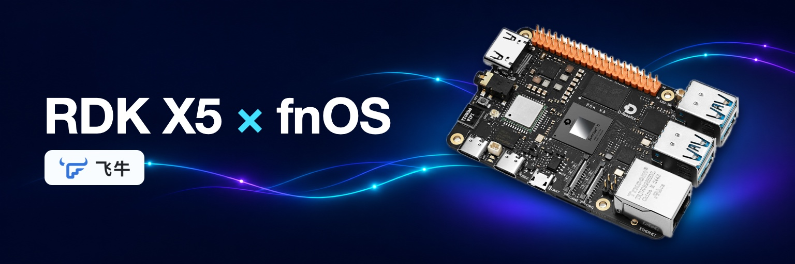

<h1 align="center">
  
</h1>

  <strong>用 RDK X5 搭建家庭 NAS</strong> 
  文件共享 · 智能相册 · 影音服务 · BPU / VPU 硬件加速

  
  
  

  <a href="#完整版安装">下载安装</a> ·
  <a href="#加速模块">相册与影视加速</a> ·
  <a href="#todo">进展与计划</a> ·
  <a href="https://github.com/xuguosheng110/rdk-x5-fnos/issues">问题反馈</a>

> **v0.3.3 社区整合预览。** 纳入用户 PR 的 Type-C 闪连、TF 单卡存储、Wi-Fi 修复和可回滚更新。完整镜像已在 X5 验证空白首次设置、原生存储创建、相册 BPU、影视 VPU、升级回滚及受控断电恢复。下载以 [v0.3.3 Release](https://github.com/xuguosheng110/rdk-x5-fnos/releases/tag/v0.3.3) 实际公开文件为准；本版保留已说明的硬件与应用版本边界。

> **启动勘误** 本板有一次普通重启发生内核 panic，自动再次启动后才恢复网络和存储。需要可靠重启的部署请暂缓使用本预览。[启动勘误](https://github.com/xuguosheng110/rdk-x5-fnos/blob/main/BOOT-ERRATA.md)

## v0.3.3 原地更新

普通用户直接烧录完整镜像，Wi-Fi 修复、CPU 策略和回滚基线已在系统内，无需通过 SSH 补装。独立更新包只适用于精确匹配的内核及原模块；社区 PR 原 v0.3.2 构建与本候选的内核摘要不同，不能混用同名版本的包。r27/v0.3.1 也不是本更新包的直接更新目标。以 [release.json](release.json) 的摘要和适用范围为准。

完整镜像的 XZ 约 2.48 GB，独立加速 FPK 约 1.30 GB。GitHub 提供镜像分卷、`merge-image.py` 和 `parts.json`；FPK 为完整单文件。校验值见 [release.json](release.json) 和 Release 的 `SHA256SUMS`。本轮通过 47 项相关测试、Linux 回归 219 项（另 7 项跳过）和 53 项成品检查，真板范围见下方验收表。开发者维护方法见 [原地更新说明](fnos/integration/in_place_update/README.md)。

## 完整版安装

1. 下载对应版本的完整系统 `.img` 或 `.img.xz`，先核对 SHA-256；`.xz` 解压后按容量确认目标 TF 卡，再整盘写入。整盘烧录会重建系统卡分区，卡内已有存储空间和应用数据请先备份；外置数据盘不作为烧录目标。GitHub 分卷需先按该 Release 的说明合并；源码 ZIP 不能直接烧录。
2. 将 TF 卡装入 X5 后上电。首次启动会将系统分区扩展到最多 16 GiB，剩余容量留给存储空间管理。已有较大系统分区不会被缩小。
3. 接上网线，在路由器中查看板卡 IP，打开 `http://板卡IP:5666/`。Windows 也可使用 Type-C RNDIS 闪连：网卡设为 `192.168.128.1/24`，访问 `http://192.168.128.10:5666/`；本轮 Mac 只验证设备枚举，Windows 客户端结果另见贡献者 PR。
4. **完成飞牛原生首次设置。** 点击「开始 NAS 之旅」，由用户自行填写设备名、
   管理员账号和密码，阅读并确认协议后进入桌面。本项目不预置用户账号、密码、
   照片、Wi-Fi 或远程访问凭据。
5. 在「系统设置 → 存储空间管理」选择 TF 卡的剩余空间，创建存储空间。也可以使用独立 USB 数据盘。需要联网安装应用时，在「网络设置」连接 Wi-Fi，或接入有线网络。
6. **安装相册和影视。** 在飞牛欢迎页选择一键安装，安装位置选择刚创建的数据卷。安装完成后，在相册中选择照片目录。
   影视在「系统设置 → 应用 → 影视 → 访问权限」授权视频目录，再添加媒体库。
   独立加速模块的安装、更新和回滚见下文。

官方参考资料：[RDK SD 卡烧录](https://developer.d-robotics.cc/rdk_x_doc/Quick_start/system-burn/burn-sd-card) ·
[飞牛首次设置](https://help.fnnas.com/articles/v1/start/install-os) ·
[飞牛存储空间](https://help.fnnas.com/articles/v1/volume/create) ·
[飞牛影视](https://help.fnnas.com/articles/v1/media/media_install)。

## 使用示例

- **家庭文件共享**。在飞牛的「系统设置 → 文件共享协议」里打开 SMB，登录另一台电脑时使用你在飞牛里创建的账号。Windows 资源管理器输入 `\\板卡IP`，macOS 的 Finder 选择「前往 → 连接服务器」，输入 `smb://板卡IP`。共享列表以飞牛文件管理的设置为准。本版在新建的 TF 数据卷上通过 SMB 3.1.1 验证了创建、改名、读写和删除，受控断电再开机后仍能读回校验文件。
- **整理家庭照片**。先在相册选择外置卷上的照片目录，再用「上传 → 上传照片」导入一小批照片。在「人物」里查看分组。已验证版本用 BPU 做人脸检测和 FaceID128 特征提取，中文语义搜索用官方 CPU 模型。
- **在浏览器看视频**。给影视授权外置卷上的视频目录并创建媒体库。用 H.264 或 HEVC 样片试播，手动切到 480p 或 720p 可以走已验证的转码路径。选择「原画」时，播放器可能直接播放文件。

## 当前版本与硬件加速

| 项目 | 本次 v0.3.3 整合预览 |
| --- | --- |
| 基础系统 | fnOS ARM 1.2.0701；Linux 6.18.0，内核 Image SHA-256 `044539fb…d741` |
| 完整镜像 | PR4 RC1，XZ 约 2.48 GB；系统分区最多 16 GiB，TF 剩余空间由飞牛创建数据卷 |
| 相册 | `trim.photos 0.9.14`；人脸检测、关键点和 FaceID128 使用 X5 BPU；原生新上传自动任务已验证 |
| 中文语义检索 | 沿用官方 CPU 路径；图像与文本 ONNX 共约 1.05 GB |
| 影视 | `trim.media 0.9.8-1`；原生 H.264 / HEVC 转码，实际 VPU 编解码通道已验证 |
| 独立模块 | `fnos-x5-accel 0.3.5`，约 1.30 GB，与此前已验收 FPK 字节一致；完整镜像包含对应运行组件 |
| 系统更新包 | 仅接受清单中的精确内核及原 Wi-Fi 模块；本板回滚、复升及重启已验证 |

完整校验值、输入来源和版本边界见 [release.json](release.json)。

展开 v0.3.0 历史版本匹配记录

[v0.3.0 历史发布页与适配源码](https://github.com/xuguosheng110/rdk-x5-fnos/releases/tag/v0.3.0)。

## v0.3.0 版本匹配（历史记录）

| 项目 | v0.3.0 |
| --- | --- |
| 系统版本 | `0.3.0`（已发布适配源码） |
| 基础 fnOS | `1.2.0701` ARM |
| 内核 | Linux `6.18.0`；配置 SHA-256 `bee5f998…ebf20` |
| 镜像 | r25 候选，原始 `.img` SHA-256 `0926654f…3112d`，逻辑大小 13,157,531,648 bytes |
| 加速模块 | `fnos-x5-accel` 构建 `0.3.5`，系统版本 `0.3.0`，1.30 GB，FPK SHA-256 `da8fc1a0…bb2b3` |
| 相册 | `trim.photos 0.9.14` 兼容路径；未知版本保留原生路径 |
| 影视 | `trim.media 0.9.8-1` 兼容路径；未知版本保留原生路径 |
| 适配源码 | r25，构建来源及真板实测见 [release.json](release.json) |

系统镜像和模块必须来自同一版本目录。不要混用 v0.2.0 镜像、其他内核或
未知版本的相册/影视二进制；模块遇到未知原生哈希会保留原生路径并报告
`unknown_native`，不会猜测性覆盖。详细变更见 [RELEASE_NOTES.md](RELEASE_NOTES.md)，
内核/config 来源见 [KERNEL.md](KERNEL.md)。

## 外置存储

可写数据卷可以来自独立 USB 数据盘，也可以在首次启动后使用 TF 卡剩余空间创建；应用、模型和索引跟随用户选择的数据卷。

- 没有可写数据卷时，应用/加速部署应等待，不能退回系统卡存放应用数据。
- 空 USB 盘由用户在原生界面创建空间；创建会清空所选盘，必须按型号、容量
  和分区事实核对。
- 已有飞牛数据卷优先使用原生导入/挂载，不执行本项目自制的格式化或覆盖。
- 117 GB 测试卷的网页卸载曾提示占用。让飞牛仅停止页面列出的文件监控后，卸载
  成功。点击「去挂载」恢复原卷，并通过读写校验。其他卷和应用保持在线。
- 卷就绪后，应用安装位置和模型/索引数据跟随原生选择；不要手工把
  `/vol1` 写死到配置。
- 已知风险：部分 USB/xHCI 组合在持续读写或重枚举时会掉线；`emergency_ro`
  表示超级块只读，不能仅看 VFS 的 `rw`。出现异常先停止写入、保留现场，
  再按原生流程恢复，不要盲目重启或重建卷。

## 加速模块

完整镜像会在用户完成原生设置并选择可写数据卷后准备应用与加速。相册和影视程序由飞牛放在系统分区，应用元数据、模型缓存和照片/视频跟随所选数据卷；本轮选择 TF 存储空间 3 后已自动完成配置。新账户在相册引导中选择备份位置并保留默认 AI 开关即可；原生上传后的识别在实测中约延迟 2 分钟启动。本次新镜像的原生上传已自动完成人脸任务，检测与 FaceID128 worker 实际使用 BPU。r27 另保留了应用重启、新账户默认 AI 和普通账户读写的验证记录。Wi-Fi 驱动和 CPU 策略随完整镜像部署，使用与该镜像绑定的更新包维护。

配套模块可从飞牛网页「应用中心 → 手动安装」安装，格式为 ARM64 `.fpk`，构建版本
`0.3.5`，系统版本 `0.3.0`。它提供相册人脸检测/关键点/FaceID128 的
worker、模型和原生入口适配，影视 VPU 编解码适配库、启动器和 drop-in，以及
与完整镜像同源的离线 Python/模型缓存。

应用中心已验证 0.3.4 全新安装、卸载恢复原生影视播放器、0.3.3 升级到 0.3.4
及热重启后的巡检。0.3.4 经应用中心升级到 0.3.5 成功，升级后两个应用运行，
定时巡检正常。

0.3.5 含三个人脸 BPU 模型，共 19.2 MB。官方语义检索使用 CPU 模型，图像与文本
编码 ONNX 共约 1.05 GB，连同飞牛人脸兼容模型和分词文件保留在离线包中。

重装相册或影视时，在飞牛卸载窗口选择「仅卸载，保留数据在原存储空间」，再安装
对应的兼容版本。加速巡检由系统定时执行，通常在数分钟内识别已知版本并恢复适配。
影视卸载会撤销原视频目录授权，即使保留了媒体库。重装后若显示「没有访问权限」，
在「系统设置 → 应用 → 影视 → 访问权限」重新授权原目录。

更新/回滚边界：

- 重复安装：文件哈希一致时返回 `already_installed`，不重写文件。
- 低空间：写入前计算新增、备份和 64 MiB 余量；不足直接失败。
- 中途失败：按事务备份逆序恢复，半成品删除，状态为 `failed`。
- 升级：只替换仍属于模块的旧文件；保留首次卸载备份，失败恢复升级前状态。
- 未知相册/影视版本：保留原生可用路径，标记 `unknown_native`；不降低版本
  检查、不重编译、不删除用户数据。
- 卸载：只删除模块创建的文件或恢复模块备份；用户照片、索引、数据库、
  人物分组和停用偏好不删除。
- 模块不写内核/驱动/固件，不执行网络下载或 `pip install`；生命周期需要
  root 写受审系统路径，安装完成后不保留常驻提权进程。

### TODO

- [x] 完整镜像与更新包共用精确 Wi-Fi/CPU 目标清单及可回滚事务。
- [x] 新镜像空白首次设置、TF 原生创建、SMB 和两块原数据卷导入。
- [x] 相册后装自动配置与新图 BPU；原生 H.264 / HEVC VPU 转码。
- [x] 回滚、复升后的两次重启，以及 CP5 s2 受控断电开机，均在一次启动内恢复服务。
- [ ] 修复 V1.0 板在网页配置无线后首次启动发生的内核 panic，并用完整串口记录复验。
- [x] GitHub 已公开预览镜像分卷、完整 FPK、匹配内核源码、更新包和启动勘误，21 项附件已核对服务端摘要。
- [ ] 百度网盘同步完整镜像、模块、源码和校验文件，并验证远端下载。
- [ ] 本构建的独立 Windows RNDIS 客户端复验。
- [ ] 跟踪贡献者 V0.1 板的偶发重启失联和接收缓冲分配告警。V1.0 板完成 450 MiB 无线接收，平均 11.44 MiB/s，两端 SHA-256 一致。详情见 [无线测试记录](TESTED.md)。
- [ ] 在更多 USB 控制器上验证长期读写和挂载占用。
- [ ] 新相册/影视版本发布后更新兼容清单并做跨版本回归；未知哈希保留原生路径。

## 真板验收

本轮使用同一块 X5 和同一匹配内核，2026-11-23 实测：

| 项目 | v0.3.3 PR4 RC1 结果 |
| --- | --- |
| 通用首次设置 | 设备名、管理员和两次密码四项为空；无预置普通用户、SSH 主机密钥或 root 登录公钥 |
| TF 与外置存储 | 系统分区 16 GiB；飞牛原生创建约 12.95 GB Btrfs TF 数据卷；既有 2 TB ext4、117 GB Btrfs 原 UUID 保留 |
| 无线页面 | 原生页面扫描、填写 SSID/密码并创建连接；删除临时联网配置后，首轮启动 panic，自动二次启动后无线与 Web/SSH 恢复 |
| SMB | 新 TF 卷经独立 SMB 3.1.1 客户端完成创建、读回摘要、改名、修改和删除；断电开机后测试文件摘要一致 |
| 相册 | 原生网页上传新图，自动完成人脸任务；检测和 FaceID128 worker 实际持有 BPU 设备；未手动触发 AI |
| 影视 | H.264 480p、HEVC 720p 转码播放至片尾附近，无浏览器播放错误；内核观察到实际 VPU 解码和编码通道 |
| 更新和回滚 | 回滚后加载原 Wi-Fi 模块、`ps_on=Y`、`schedutil`；复升后加载修复模块、`ps_on=N`、`performance`；三卷测试文件摘要保持 |
| 受控断电恢复 | 正常关机达到内核 Power down 后，仅 CP5 s2 断电 5 秒再上电；三卷、应用和无线网络恢复 |
| Type-C | Mac 实际枚举到 RDK X5 fnOS USB Ethernet；贡献者另有 Windows RNDIS 联网记录，本构建未独立测试 Windows 客户端 |

写卡保留源文件摘要、介质身份、全长度写入和刷盘记录，按维护者要求跳过整卡物理回读。相册算法准确率及既有 CPU CLIP 结论没有重复跑一轮；本轮核对的是完整镜像、后装应用与重启后的接入链路。

展开 r24 / r25 等历史基线与独立 FPK 安装记录

| 项目 | 真板实测结果 |
| --- | --- |
| 首次设置、自动扩容 | 原生首次设置字段为空。32 GB 系统卡首启扩至 29.5 GiB，热重启后容量保持。 |
| 有线、无线、SMB | 飞牛网页配置 Wi-Fi。独立无线客户端成功访问，重启后自动重连。Mac 经 SMB 读取已有共享目录。 |
| 外置存储 | 已有 ext4/Btrfs 卷由原生界面导入，重启后自动挂载。117 GB USB 盘通过网页新建 Basic/Btrfs，读写校验通过。热重启后新卷自动挂载，继续通过读写校验。 |
| 相册 | 原生上传和人物分组通过。真板记录到人脸检测与 FaceID128 使用 BPU，中文语义检索沿用官方 CPU 路径。 |
| 影视 | 原生 H.264、HEVC 转码播放通过，内核计数确认 VPU 编解码。短 HEVC 片尾切到 720p 在升级前通过三次，升级并重启后复测通过。 |
| 独立 FPK | r25 经应用中心全新安装 0.3.5，热重启后巡检恢复。r24 上的 0.3.4 全新安装、重启巡检、卸载播放器还原通过。0.3.3 至 0.3.4 原生升级及重启后回归通过。 |
| 原生应用重装 | 相册 0.9.14、影视 0.9.8-1 原生卸载保留数据，分别重装同版本。608 张照片和 10 个测试视频清单及哈希一致。人物页正常，影视重新授权目录后硬件转码恢复。 |

r24 和 r25 均实测 117 GB USB 盘在原生网页新建 Basic/Btrfs，热重启后自动挂载。r25 的同一新 UUID 在重启前后各通过 16 MiB 读写校验。完整证据范围见 [TESTED.md](TESTED.md)。

### 社区贡献

感谢 [maxma615](https://github.com/maxma615) 提交 [#2](https://github.com/xuguosheng110/rdk-x5-fnos/pull/2) 的 Type-C、单卡存储与应用兼容改进，以及 [#3](https://github.com/xuguosheng110/rdk-x5-fnos/pull/3) 的 Wi-Fi 修复和可回滚更新。本轮集成分支保留这些提交及作者信息。[#1](https://github.com/xuguosheng110/rdk-x5-fnos/pull/1) 的导航和移动端阅读思路也用于本页，封面继续使用 X5 实物与飞牛 Logo。

## 源码、协议与分发范围

本仓库公开的是 X5 适配层、镜像组装辅助、原生相册/影视适配和独立模块源码；
不包含用户照片、索引数据库、私钥、凭据、远程访问配置、开发协调日志、未采用
的模型或构建垃圾。镜像和模块中的 fnOS 用户态、Linux、D-Robotics 运行库/模型
分别适用其上游许可；本项目原创适配代码采用 [MIT License](LICENSE)，第三方
边界见 [THIRD_PARTY.md](THIRD_PARTY.md)。

维护者已确认本版本 fnOS 与 D-Robotics 组件的再分发许可。分发保留各组件原有
许可证、版权和归属；内核 GPL 对应源码随版本提供，原创适配层的 MIT 许可范围
见 [LICENSE](LICENSE)，第三方组件范围见 [THIRD_PARTY.md](THIRD_PARTY.md)。

源码暂存和逐文件来源见 [SOURCE-MAP.md](SOURCE-MAP.md)。v0.2.0 历史版本及
旧镜像入口保留在 Git 历史/Release 中，不与本候选混用。

[飞牛帮助中心](https://help.fnnas.com/) · [飞牛论坛](https://club.fnnas.com/) ·
[RDK 社区](https://forum.d-robotics.cc/) · [RDK BSP](https://github.com/D-Robotics/x5-rdk-gen) ·
[问题反馈](https://github.com/xuguosheng110/rdk-x5-fnos/issues)

这是社区适配项目，不代表飞牛或 D-Robotics 官方背书。封面素材来自
[Switch Science 的 RDK X5 产品页](https://www.switch-science.com/products/10500)
和 [飞牛官网](https://fnnas.com/)。
