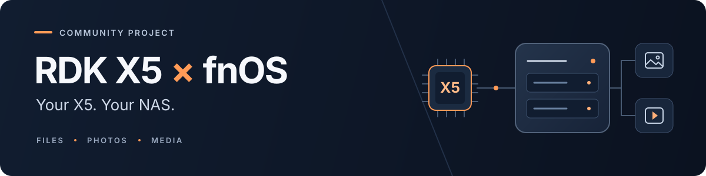

<h1 align="center">
  
</h1>

<p align="center">
  <strong>用 RDK X5，搭建你的家庭 NAS。</strong><br>
  文件共享 · 智能相册 · 影音服务 · BPU / VPU 硬件加速
</p>

<p align="center">
  <a href="https://github.com/xuguosheng110/rdk-x5-fnos/releases"></a>
  
  
</p>

<p align="center">
  <a href="#下载与安装">下载与安装</a> ·
  <a href="#已验证功能">功能与进展</a> ·
  <a href="#日常使用与常见问题">使用帮助</a> ·
  <a href="TODO.md">开发计划</a> ·
  <a href="https://github.com/xuguosheng110/rdk-x5-fnos/issues">问题反馈</a>
</p>

---

**RDK X5 × fnOS** 是面向 RDK X5 的飞牛 fnOS ARM 社区适配项目。项目补充启动、网络、存储及 BPU / VPU 适配，让开发板可以运行飞牛的 Web 桌面、应用中心、相册和影视服务，用于家庭文件共享、照片整理与影音播放。

> **版本说明**：[v0.2.0](https://github.com/xuguosheng110/rdk-x5-fnos/releases/tag/v0.2.0) 提供适配源码与存储修复资料；已公开的完整系统镜像见 [v0.1.0 家庭共享版](https://github.com/xuguosheng110/rdk-x5-fnos/releases/tag/v0.1.0)。内核归档及下载说明以对应 Release 页面为准。

## 已验证功能

以下应用结果来自 **v0.1.0 真板验收**。完整测试条件与结果见 [TESTED.md](TESTED.md)。

| 功能 | 已验证内容 |
| --- | --- |
| **启动与网络** | SD 镜像烧录及全量回读校验；有线 Web / SMB；Wi-Fi 原生配置与受控冷启动自动重连。 |
| **文件与共享** | 文件上传、下载、回收站恢复、SMB 读写及原生备份。 |
| **相册 · BPU** | 官方人脸检测、106 点关键点、FaceID128 与人物分组；冷启动后分组保留。 |
| **影视 · VPU** | H.264 / HEVC 渐进式 8-bit、4:2:0 SDR 样本硬件解码与编码。 |
| **应用与容器** | 原生应用升级、非 root 应用与容器跨 UID 共享读写。 |
| **WebDAV** | 数据卷缓存、冷启动自动挂载、排队上传服务崩溃后恢复与远端校验。 |

**加速范围**：人脸模型使用 BPU；中文语义搜索和视频缩放仍使用 CPU。10-bit、HDR、4:4:4 等未支持格式保留软件回退，不承诺全格式硬件转码或 4K60。

### v0.2.0 存储修复进展

- **已验证**：Linux 6.18.0 #5 在原测试系统上通过 120 GB U 盘 Basic / Btrfs 创建、读写及冷启动复挂校验；r16 完整镜像通过烧录回读、首启和已有 Basic 卷导入。
- **待验证**：全新 r16 系统的空白盘新建卷、双盘 ext4 RAID1 与真实超时故障注入。早期 16 GB U 盘持续读写掉线的原因仍待定位。

详见 [修复说明](RELEASE_NOTES.md) 与 [存储测试记录](docs/storage-create-validation.md)；下载材料与内核归档状态见 [v0.2.0 Release](https://github.com/xuguosheng110/rdk-x5-fnos/releases/tag/v0.2.0)。

## 下载与安装

### 1. 选择版本

| 用途 | 入口 | 内容 |
| --- | --- | --- |
| **体验公开镜像** | [v0.1.0 家庭共享版](https://github.com/xuguosheng110/rdk-x5-fnos/releases/tag/v0.1.0) | Release 正文提供完整镜像的百度网盘入口；GitHub 附件提供源码与校验资料。 |
| **参与适配与构建** | [v0.2.0 源码发布](https://github.com/xuguosheng110/rdk-x5-fnos/releases/tag/v0.2.0) · [组装文档](fnos/integration/image_assembly/README.md) | 适配源码与存储修复补丁；内核归档获取方式见 Release。构建还需同版本 fnOS ARM 用户态、RDK BSP、厂商运行库与模型。 |

**源码 ZIP 不能直接烧录。** 以下步骤适用于完整系统镜像；当前公开的 v0.1.0 镜像不包含后续 v0.2.0 存储修复。第三方组件的使用范围见 [许可说明](THIRD_PARTY.md)。

### 2. 准备硬件

| 准备项 | 要求与建议 |
| --- | --- |
| 板卡 | **RDK X5**；其他 ARM 板卡不在本项目适配范围内。 |
| 系统卡 | SD 卡，建议 **32 GB 或以上**；烧录会覆盖卡内原有内容。 |
| 数据盘 | 独立 USB 存储设备；已有数据先备份，系统卡不能当作待格式化的数据盘。 |
| 网络与供电 | 首次启动建议使用有线网络；使用符合 RDK 官方要求的电源，多盘或机械硬盘需考虑独立供电。 |

### 3. 校验并烧录

1. 从对应 Release 页的下载入口获取完整镜像，并下载 `SHA256SUMS`，核对文件的 SHA-256。
2. 解压 `.xz`，得到整盘 `.img`，使用整盘镜像烧录工具写入 **系统 SD 卡**。
3. 完成后按工具提示校验，再将系统卡装回板卡。

> **核对目标盘**：烧录会覆盖所选磁盘。请确认选中的是 X5 系统 SD 卡，不要写入数据盘。

<details>
<summary><strong>进阶：通过 U-Boot 将 SD 卡映射到电脑</strong></summary>

RDK X5 已有 U-Boot 时，可经串口执行：

```text
ums 0 mmc 1
```

在电脑上核对映射出的设备确为板卡 SD 卡，再进行整盘写入。`ums 0 mmc 0` 对应 eMMC，不是本版本已验证的 SD 部署目标。

</details>

### 4. 首次启动

1. 接入网络并上电，在路由器设备列表中找到 X5 的 IP。
2. 浏览器打开 **`http://板卡IP:5666/`**，按页面引导创建自己的账号。
3. 选择存储卷与应用位置：**已有飞牛数据卷选择挂载**；在空白盘上创建空间会清除所选盘的数据。
4. 等待相册、影视及所需模型准备完成，再选择媒体目录；模型准备需要网络和时间。Wi-Fi 可在原生网络页面配置。

已验证的日常功能无需通过 SSH 手动打补丁或部署 AI 模型。通用镜像不预置固定 IP、个人密码、Wi-Fi 凭据或开发 SSH 密钥。

## 日常使用与常见问题

| 操作 | 入口 |
| --- | --- |
| Web 桌面 | 浏览器访问 `http://板卡IP:5666/`。 |
| 磁盘管理 | 系统设置 → 存储空间管理。 |
| Windows 共享 | 创建共享文件夹并启用 SMB 后，在资源管理器地址栏输入 `\\板卡IP`。 |
| macOS 共享 | Finder → 连接服务器，输入 `smb://板卡IP`。 |
| 相册与影视 | 从应用中心安装或打开应用，在原生界面选择数据目录。 |

<details>
<summary><strong>“权限未适配”是否影响使用？</strong></summary>

本版采用家庭共享读写策略，已测文件、相册、影视、备份及应用共享路径可用。该提示保留；本版不提供原生 Windows ACL v2 逐用户隔离，**请勿执行权限转换**。系统目录和账号认证仍受保护。

它与“创建存储空间失败”是两个独立问题，不能通过权限转换解决后者。

</details>

<details>
<summary><strong>无法创建存储空间怎么办？</strong></summary>

记录镜像版本、板卡型号、U 盘型号与容量、已有分区情况，以及完整错误信息，通过 [Issues](https://github.com/xuguosheng110/rdk-x5-fnos/issues) 反馈。提交前去掉密码、令牌和私人文件名，不要反复格式化试错。

`main` 已包含存储修复进展，但全新 r16 系统的空白盘新建卷与多设备兼容性仍在验证。详见 [存储测试记录](docs/storage-create-validation.md)。

</details>

<details>
<summary><strong>找不到板卡 IP，或无法打开桌面？</strong></summary>

先接有线网络，在路由器 DHCP / 设备列表中找到 X5，再访问 `http://板卡IP:5666/`。不同板卡或重装后的地址可能变化，不要照搬开发机地址。通用镜像没有预置管理员密码，首次安装需在页面创建账号。

</details>

<details>
<summary><strong>系统如何更新？</strong></summary>

升级前保存数据与配置，使用本项目后续经过验证的镜像。为保留 X5 启动链，通用系统自动更新、无人值守升级及不匹配的启动固件更新已禁用；请勿直接升级通用 fnOS 内核或启动固件。

</details>

## 使用范围与已知限制

- **家庭共享**：数据卷不提供 Windows ACL v2 逐用户权限隔离；保留“权限未适配”提示，请勿执行权限转换。
- **存储兼容性**：新建卷、多品牌 USB 存储、热插拔及 RAID 仍有待验证项；已有卷的读写不能代替空白盘创建验收。
- **可靠性**：已测受控关机后的冷启动与服务恢复；未完成意外断电、长期稳定性和所有第三方应用验收，不承诺正在写入或未上传的数据突然断电无损。

具体进展与后续安排见 [TESTED.md](TESTED.md) 和 [TODO.md](TODO.md)。

## 开发与贡献

欢迎反馈兼容性问题、补充实测结果或提交改进。开始前请阅读 [测试指南](TESTING.md)、[真板结果](TESTED.md) 与 [开发计划](TODO.md)；离线测试通过不能替代真板验收。

<details>
<summary><strong>源码导航与构建说明</strong></summary>

| 路径 | 内容 |
| --- | --- |
| [`fnos/integration/image_assembly`](fnos/integration/image_assembly) | 离线镜像组装、原生服务适配与首次启动准备。 |
| [`fnos/integration/native_media`](fnos/integration/native_media) | 原生多媒体桥接。 |
| [`fnos/integration/native_photos`](fnos/integration/native_photos) | 人脸、相册适配及模型来源。 |
| [`fnos/integration/acceleration`](fnos/integration/acceleration) | 共享存储与 BPU / VPU 辅助代码。 |
| [`fnos/lab`](fnos/lab) / [`fnos/integration/hardware`](fnos/integration/hardware) | 开发者设备核验、串口、烧录与诊断工具。 |
| [`fnos/tests`](fnos/tests) / 各子目录 `tests` | 离线回归测试。 |
| [`patches`](patches) / [`fnos/patches`](fnos/patches) | 内核与上游组件补丁。 |

仓库公开适配层，不包含私有实验室日志、账号、模型二进制或第三方完整 rootfs，不能仅靠本仓库独立重建完整闭源系统。构建时需按组装器要求提供依法取得的同版本组件；内核源码快照与上游 BSP 精确提交的对应关系仍待核实。

实验室工具不是普通用户安装的必需步骤，使用前必须绑定自己的设备，不能照搬实验室设备路径。`merge-image.py` 与 `parts.json` 对应 v0.1.0；子目录文档包含历史开发记录，发布范围以对应 Release 和测试记录为准。

</details>

## 官方资料与参考项目

| 资料 | 入口 |
| --- | --- |
| 飞牛使用与帮助 | [官网](https://www.fnnas.com/) · [帮助中心](https://help.fnnas.com/) · [官方论坛](https://club.fnnas.com/) |
| RDK 硬件与社区 | [RDK 官方文档](https://developer.d-robotics.cc/rdk_doc/) · [地瓜社区](https://forum.d-robotics.cc/) |
| RDK 构建与 BSP | [x5-rdk-gen](https://github.com/D-Robotics/x5-rdk-gen) · [x5-manifest](https://github.com/D-Robotics/x5-manifest) |
| 人脸模型参考 | [D-Robotics/faceid](https://github.com/D-Robotics/faceid) · [模型来源清单](fnos/integration/native_photos/model-sources.json) |
| Linux 内核基线 | [Linux 6.18](https://git.kernel.org/pub/scm/linux/kernel/git/torvalds/linux.git/tag/?h=v6.18)；不包含本项目全部 X5 BSP 改动。 |
| ARM NAS 适配参考 | [ophub/fnnas](https://github.com/ophub/fnnas)（第三方项目） |

## 许可与声明

原创独立适配代码与文档按 [MIT License](LICENSE) 发布；已有 SPDX、第三方版权和上游衍生代码保留原许可证。Linux、飞牛系统、D-Robotics 库与模型分别遵循各自条款，详见 [第三方组件与许可](THIRD_PARTY.md) 和 [飞牛最终用户许可协议](https://fnnas.com/terms)。

本项目由社区维护，不是飞牛或地瓜官方发行版，也不代表厂商支持与背书。
