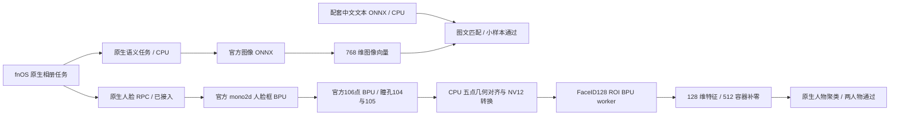

# X5 原生相册加速适配

## 2026-11-10 最新状态

官方 BPU 人脸检测已替换原生 CPU 检测，并通过真实 fnOS 相册自动增量验收。当前默认链路：官方 `mono2d_body_detection` 人脸框 → 官方 `face_landmarks_detection` 106 点 → FaceID128，三个神经网络均运行在 BPU；图像解码、缩放、NV12 转换和仿射对齐仍由 CPU 完成。无需 ROS 守护进程，用户不需安装模型或手动启用补丁。

修复五点映射：104/105 是瞳孔，74/83 是上眼睑，不能混用。真实等比例双人图同人匹配最低从 0.533128 提升至 0.811600；阈值 0.64 未降低。11 张单人变体同人最低 0.985472，异人最高 −0.062650。原生 Web 上传 4 张 A/B/双人/无脸图片后，后台自动识别并加入旧索引，最终两个人物组为 12/10；未重置或写入结果数据库。捕获 236 次 BPU ioctl，未打开 CPU det.onnx。并行语义服务仍使用 ONNX Runtime CPU，不与人脸检测混为一谈。

相册 r6 包包含 7,887 项载荷与清单，7,888 项归档读回全部通过，SHA256 `f05ab9ce8233b793f23b7360b1624c5973954a8d1ff0fa7e428718d510c3b62f`。Mac/Linux 各29项回归通过。完整 r9 已在指定服务器完成组装及48项离线检查，独立只读挂载核对新模型、入口、配置和依赖通过；尚未烧录或干净首启，工程板在线。两名公开人物不等于通用准确率验收；旧模型 HBRT3.15.47 与运行库3.15.55 警告保留。

证据：`official-face-replacement-acceptance-r1.json`、`official-face-identity-r2.json`、`official-face-native-r3.json`、`official-face-native-r3.trace`、`native-photos-r6-package.json`，均在 `fnos/logs/native-product-20261109/`。

## 较早阶段记录

05:55：相册r4已进入完整r8候选并通过最终镜像读回，真板尚未部署r4。它修复首次模型命名空间标记短写后无法重试的问题：同目录临时文件完整写入并fsync后排他发布，清理临时名并同步目录。真实短写用例修复前失败、修复后通过，Mac与Linux各28项相关回归通过；这不等于物理断电验收。完整r8 SHA256为`089d3553e3a172aa47c4b042e97563b61d9397a2ee5b5a383be9d71f2f7ff9d2`，48项离线关键检查通过，板卡离线、干净首启仍待验。下列r3真板结果保留为独立历史证据。

FaceID128 r3 已在原生相册中通过两人物与自动增量测试：新增第 12 张公开人脸图后自动形成 7/5 两组，没有手动重置或写入数据库结果。检测与五点对齐仍 CPU，特征使用 D-Robotics/faceid 的 `config/x5/faceID.hbm`。这是小样本闭环，尚不是通用准确率或完整系统验收。

r3 每次请求重新发现挂载数据根，补齐 `/vol02`，空卷状态可以等待后续挂载。同一工作进程在 `/vol00/01/02` 受控 tmpfs 挂载前拒绝、挂载后推理、卸载后拒绝均通过；这是命名空间测试，不冒充真实 USB/云提供方验收。当前 FaceID128 路径新捕获 25 次 BPU ioctl。

**此前的 InsightFace 路径不能用于交付。** 六张同人测试只验证了调度链路。扩展第二人物后，旧模型把 11 张图合为一人，同人余弦最低 0.86315，异人最高 0.94074，两类重叠。更改 NV12 紧凑布局并未改变结果；重复相同图结果完全一致，未观察到随机推理漂移。没有靠调阈值掩盖此问题。改用仓库提供的 FaceID128 后，同人最低 0.990858，异人最高 −0.076650，原生默认阈值即可分开。旧模型或转换路径问题的进一步根因仍未确定，该分支保留作对照，不再作为默认交付模型。

FaceID128 输出为 128 维 S32，物理张量每四个元素取一个，与上游 `FaceIDExtractor` 一致。为兼容既有 RPC 的 512 长度容器，余下 384 个位置补零，归一化后的余弦距离不变；不称其为 512 维学习特征。模型 SHA256 `aa3ab3230f0957bc60a9b0c3dbd21e7900a14fe7aa7b1031f3b78fb0e0ab7ce1`，工作程序 SHA256 `a05bd0d2748bde0b38738052f99a7a6b76c22406f65c0b3c4989e47eee82c48e`。

切换前确认脸索引全部来自本项目公开测试图且无命名人物，保存 `face128-before-87uva1zi` 数据库和入口备份；通过原生 Photos 重置重识别，未写数据库伪造分组。新命名空间 `drobotics-faceid128-aa3ab3230f0957bc`，不能与旧模型混用。自动发现挂载数据卷，不要求用户逐项设置路径权限。

原生中文语义搜索已完成两组小样本验收：“宇航员”返回 7 张 A 组，“穿西装的男人”返回 5 张 B 组，页面结果 UUID 与数据库文件名核对一致。它使用官方 768 维图像/文本 ONNX、运行在 CPU；现有实验 512 维英文 CLIP 不能与该索引混用，BPU 语义加速仍未完成。

04:25 补充：同一原生 768 维图像模型已完成 opset17→11 等价转换和 X5 官方编译检查。50 处 LayerNormalization 按 ONNX 公式展开；97 处 Reshape、12 处 Unsqueeze 和 12 处 Softmax 保留原语义，249 份学习参数逐字节不变。9 组输出对比最大误差 4.054e-6，最小余弦 0.999999999592；10 项版本边界回归通过。`hb_mapper 1.24.3 / bayes-e` checker 生成 13 个 BPU 子图，算子表 669 项 BPU、12 项 CPU Softmax。此结果仅证明浮点等价和编译可行，checker 使用固定阈值，不能交付作精度合格模型。实际校准、量化评估、运行库兼容与真板验证继续单独完成，尚未替换原生模型或加入 r7 镜像。

06:10 数值验收：第10项配置首次通过固定28图门槛，最小余弦0.997407722、平均0.998384413、对应向量检索top1为1。fc2权重误差解决后，进一步定位到12个INT8注意力出口；让已有CPU注意力与归一化之间的24个形状操作保持CPU，消除了往返量化误差。新768D ARM worker及59文件真板探针材料已构建并完成完整性检查，但尚未在X5运行，也未验证原生中文检索或性能。r8仍使用原生CPU中文语义，前9项失败保留为历史。详见`native-semantic-bpu-conversion-20261110.md`及`semantic-attention-exit-cpu-heldout-r1.json`。

构建工具：`convert_semantic_onnx.py`、`calibrate_semantic.py`、`evaluate_quantized_semantic.py`；仅在指定服务器的 X5 工具链容器运行。公开 COCO128 固定随机分为 100 张校准与 28 张留出图，图片哈希和分组清单保留，测试图不进入系统镜像。详见 `fnos/docs/native-semantic-bpu-conversion-20261110.md`。

证据：`fnos/logs/native-product-20261109/native-semantic-and-face-r3-acceptance.json`、`photos-storage-r3-runtime.txt`、`face128-r3-hotmount-bpu-ioctl.trace`。`runtime_identity_probe.py` 提供可失败的真板跨人物特征回归，原生 UI 分组单独验收。更大人物集、视频/异常图、整机重启和完整镜像预置仍未完成。

较早r8候选已包含原生CPU语义、FaceID128 BPU、运行库、首启服务、相册r4与家庭存储r17，离线完整读回通过；尚未完成该镜像的干净首启及最终产品验收。最终用户不需要执行这些工程验证脚本。

## 已实现

- `backend.py`：限定数据目录的图像读取、CLIP 预处理、模型 SHA 校验、常驻 worker、超时和崩溃回收、归一化特征。
- `service.py`：使用本机 fnOS ARM 1.2.0701 的 `HttpService` 实现 `inferImg2Vec`；Unix socket 0600，并沿用原生 root-peer 检查。实际请求为 `POST /`，JSON `{"method":"inferImg2Vec","body":{"image":"绝对路径"}}`。
- `official_detector.py` 与 `../acceleration/face_detection_worker.c`：固定官方模型SHA、BPU框与106点推理、跨进程协议、超时回收及坐标还原；不回退CPU神经网络。
- `face.py`：五点对齐、NV12转换、默认FaceID128 worker及历史InsightFace对照。
- `../acceleration/clip_worker.c`：默认编译 CLIP；`-DFNOS_FACEID` 编译 InsightFace。后者采用 `hbDNNRoiInfer`，处理 112×112 有效图像与 128 字节行对齐。普通 `hbDNNInfer` 对该模型返回无效参数，不能混用。
- `../acceleration/model_inspect.c`：检查真实模型的类型、布局、量化、有效形状、对齐形状及内存大小。

## 2026-11-09 真板证据

- CLIP：官方狗图输出 512 维；配套文本模型在四个候选中匹配 `a dog`；重复结果完全一致。
- 原生 RPC：独立验证端点调用真实 BPU 返回 512 维；越界路径与不合法请求被拒绝；正常关闭服务退出码 0。尚未注册到相册任务调度。
- InsightFace：仓库自带 `960x544.nv12` 与官方反馈 ROI，输出 512 维且重复一致；亮度 +5 的余弦相似度 0.99558。单次热调用约 21.7 ms，不能当作吞吐基准或识别准确率。
- 五点对齐：模板恒等映射、退化点、非有限点、越界点检查通过。上述人脸样本使用官方 ROI 缩放，不是检测器与五点对齐的端到端验收。
- `faceid-bpu-ioctl.trace` 记录 `/dev/bpu_core0` 上实际推理 ioctl；原始证据在 `fnos/logs/native-integration-20261109/`。
- BPU 兼容模块保留 PASS-WAIVER；CLIP 模型编译器 3.15.47 与运行库 3.15.55 的版本告警仍存在。

## 交付前仍需完成

1. 原生人脸任务入口、两人物和新模型自动增量已经通过；继续验证多脸、小脸及异常图像，补测取消、重试和重启恢复。
2. 768 维中文图文语义对已在原生调度上通过小样本 CPU 验收，继续评估匹配的 BPU 转换。不能把实验 CLIP 特征混入原生索引；切换需使用独立命名空间并重建对应索引。
3. 把模型、worker、Python 运行依赖、启动入口及命名空间核验预置到干净镜像，让原生 AI 应用安装和启动自动生效。
4. 存储 r17 已使用持久配置，补齐非 root 应用安装目录及普通容器默认 ACL 继承；仍需在完整镜像首启和冷启动后重新验证上传、目录配置、人物展示及存储访问。此前使用旧USB映射未恢复的问题已由正确s2冷启动解决，当前工程板在线；完整镜像首启仍待验。

## 来源

- [D-Robotics/faceid](https://github.com/D-Robotics/faceid/tree/1d2dee111b813cf6bf45373f6a9859e2c4e3fc02)，Apache-2.0；模型、C++ 适配与 ROI 方式作为参考，不引入 ROS 2 守护进程。
- [D-Robotics/rdk_model_zoo CLIP](https://github.com/D-Robotics/rdk_model_zoo/tree/218a3e78970c3f1ee117d59586cf8dd3ada3864f/samples/vision/clip)。
- [InsightFace 五点模板](https://github.com/deepinsight/insightface/blob/master/python-package/insightface/utils/face_align.py)，用于对齐坐标与行为核对。
- [X5 BPU SDK API](https://developer.d-robotics.cc/oe_x5_doc/en/runtime/source/bpu_sdk_api/bpu_sdk_api.html)。

## 2026-11-10 09:55 真板补测

X5 已通过 s2 电源通道冷启动恢复。semantic768 候选数值模拟通过，但首次实际推理报 `hbrtErrorIllegalStride`，单张公开图可稳定复现；输入输出连续 F32 张量的形状、步长和字节数匹配，进一步定位内部布局/运行时兼容性。实验未替换原生 CPU 中文语义或相册索引，不能将 BPU ioctl 次数视为推理通过。证据：`fnos/logs/native-product-20261109/semantic768-single-repro-r1.json` 与 `semantic768-tensor-properties-r1.json`。

官方检测模型：[mono2d_body_detection](https://github.com/D-Robotics/mono2d_body_detection/tree/ff30fa3c554973e1a9b22b9efbcb58d366052c29)；关键点模型：[face_landmarks_detection](https://github.com/D-Robotics/face_landmarks_detection/tree/b6160bd3471f6be3018dec93c95090222dcd550c)。用户提供的年龄示例使用上述检测链路，本次不增加年龄推断功能。
